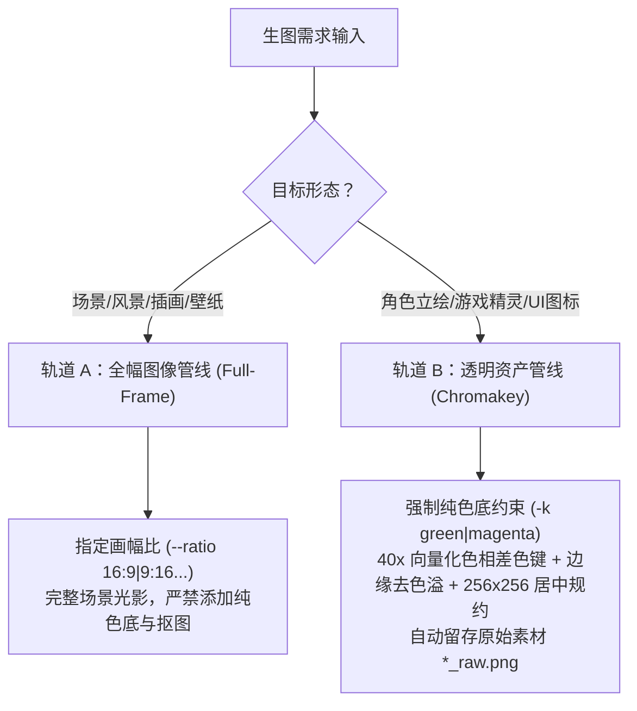

# agy-imagegen-skill

<div align="center">

> **面向 Google Antigravity、AI Agent 与游戏/UI 工作流的通用生图与专业色键资产规约双轨工具链。**

[](https://github.com/Shirolin/agy-imagegen-skill/actions/workflows/ci.yml)
[](LICENSE)
[](https://www.python.org/downloads/)
[](https://github.com/Shirolin/agy-imagegen-skill)

</div>

---

## 🌟 核心视觉展示 (Visual Showcase)

本工具链原生兼顾**自然全景艺术创作**与**工业级透明资产工程化规约**：

### 轨道 A：全幅场景原画 (Full-Frame Track)
> *不施加纯色底，不开启色键，16:9 宽屏风景构图与光影完整呈现。*

```text
Prompt: "Studio Ghibli style anime concept art of a legendary floating castle island in the sky..."
Command: agy-img "<prompt>" -o dist/ghibli_laputa_castle.jpg --ratio 16:9
```
<div align="center">
  
</div>

---

### 轨道 B：专业透明游戏资产与色键规约 (Chromakey Track)
> *大模型原生无法吐出干净透明背景。我们通过纯色底锁定 + 40x 向量化色相差色键 + 去溢色（Despill）+ 呼吸留白居中，实现真正可进引擎的游戏/UI 切片，同时安全留存原始素材。*

| 步骤 1：大模型原生绿底出图 (`cyber_wolf_raw.png`) | 步骤 2：自动色键剔除 + 去绿边 + 居中规约 (`cyber_wolf.png`) |
| :---: | :---: |
|  |  |
| **原始素材保全**：1024×1024 纯霓虹绿底 (#00FF00) | **交付成果**：256×256 干净透明底，4% 呼吸边距居中，边缘无绿边 |

---

## 🚀 核心架构与特性



1. **资产形态双轨制**：
   - **全幅轨道 (Track A)**：支持全套画幅比例（`16:9`, `9:16`, `1:1`, `4:3`, `3:4`, `2:3`, `3:2`），多模态垫图风格迁移（`--ref`）；
   - **透明切片轨道 (Track B)**：一键完成绿底/洋红底剔除、边缘去溢色（Despill）、真实不透明包围盒（Bbox）裁剪与规范居中（`--canvas 64|128|256`）。
2. **草木系主体洋红底避让**：
   - 绿色史莱姆、草系精灵、翡翠道具使用洋红底（`-k magenta`），彻底避免绿色主体被传统绿幕算法误剔除。
3. **工业级鲁棒底座**：
   - **防管道死锁**：基于底层非阻塞聚合通信，防御 64KB+ 高日志输出挂起；
   - **素材安全保全**：开启抠图时自动保留未抠图原图（`*_raw.png`），绝不破坏初始素材；
   - **单例互斥锁**：依托操作系统内核句柄锁（Windows `msvcrt` / POSIX `fcntl`），防止多任务并发冲突；
   - **安全沙箱防逃逸**：路径边界检测，杜绝输入垫图被误判为生成产物，位图魔数核验。
4. **自适应宿主执行**：
   - 在 Antigravity 对话中优先调度原生 `generate_image` 工具；在命令行与 CI 环境无缝回退至 `agy-img`。

---

## 📦 快速安装 (Installation)

### 选项 1：一键安装（推荐）

#### Windows (PowerShell 7)
```powershell
pwsh -File .\install.ps1
```

#### Linux & macOS (POSIX Shell)
```bash
./install.sh
```

> **该脚本将自动完成**：
> 1. 验证 Python 3.10+ 环境并安装 `Pillow`；
> 2. 将 `bin/` 加入用户 `PATH`（立即广播生效）；
> 3. 将本技能软链至全局 `~/.gemini/config/skills/agy-imagegen`，让智能体在任意工作区均可无感调用。

### 选项 2：通过 Python 包安装
```bash
pip install -e .
```
安装后直接在全局终端执行 `agy-img` 与 `chromakey` 命令。

---

## 🛠️ CLI 常用命令 (Cheatsheet)

### 1. 轨道 A：全幅图像生成（场景 / 插画 / 壁纸 / 垫图）
```bash
# 宽屏概念场景原画 (16:9)
agy-img "Cinematic fantasy castle on a floating island, golden hour, matte concept art" -o dist/castle.png --ratio 16:9

# 移动端竖屏壁纸 (9:16)
agy-img "Cyberpunk alleyway with neon signs, wet asphalt reflection, volumetric rain" -o dist/wallpaper.png --ratio 9:16

# 垫图风格迁移 (传入线稿草图，生成目标画风)
agy-img "Transform this sketch into Studio Ghibli watercolor illustration" -o dist/scene.png --ref ./sketch.png --ratio 4:3
```

### 2. 轨道 B：透明资产规约（一步到位出图 + 抠图 + 规约）
```bash
# 生成 256x256 战狼立绘（自动绿底剔除 + 去绿边 + 居中留白，同时保留 test_wolf_raw.png）
agy-img "A fierce cyber wolf boss, glowing red armor, solid pure neon green background (#00FF00)" -o dist/test_wolf.png -k green --canvas 256

# 绿色史莱姆精灵（洋红底避让，规约到 64x64）
agy-img "Cute green forest slime monster, pixel art, solid pure vivid magenta background (#FF00FF)" -o dist/test_slime.png -k magenta --canvas 64
```

### 3. 离线/批量后处理已有的纯色底图片
```bash
# 批量处理整个目录，40x+ 向量化加速规约至 128x128
chromakey art-inbox/sprites/ -o raw-assets/sprites/ --bg green --canvas 128
```

---

## 💻 Python 进程内直接调用 (SDK Usage)

在自定义流水线、游戏打包脚本或自动化任务中，可直接导入核心深模块：

```python
import pathlib
from scripts.engine import generate_image_asset

# 1. 生成 16:9 全景插画
scene_path = generate_image_asset(
    prompt="A cozy coffee shop in rainy night, warm lighting",
    output="dist/coffeeshop.png",
    ratio="16:9"
)

# 2. 生成 128x128 透明道具切片
sword_path = generate_image_asset(
    prompt="A legendary flaming sword, golden hilt, solid pure neon green background",
    output="dist/sword.png",
    ratio="1:1",
    chromakey="green",
    canvas=128
)
print(f"Generated asset: {sword_path}")
```

---

## 📂 仓库目录结构 (Single Source of Truth)

本项目严格践行单一事实源（Single Source of Truth）设计，仓库根目录即为自包含标准技能：

```text
agy-imagegen-skill/
├── .github/
│   ├── workflows/ci.yml              # 跨平台 (Ubuntu/Win/macOS) CI 门禁矩阵
│   ├── ISSUE_TEMPLATE/               # Bug 报告与功能提案模板
│   └── pull_request_template.md      # PR 提交清单
├── bin/                              # 跨平台 CLI 薄适配器 (含 +x 权限)
│   ├── agy-img (sh, ps1, cmd)        # 生图与规约统一入口
│   └── chromakey (sh, ps1, cmd)      # 独立色键批量规约工具
├── docs/
│   ├── adr/                          # 架构决策记录 (ADR 0001)
│   └── agents/                       # 智能体规范文档 (Issue Tracker / Domain)
├── examples/
│   └── quickstart.md                 # 典型场景快速上手示例
├── references/                       # 核心技术规范
│   ├── chromakey.md                  # 色相差数学公式与去色溢原理
│   └── prompting.md                  # 双轨提示词与画风修饰指南
├── resources/
│   └── standards.json                # 画幅比速查表与标准画布矩阵
├── scripts/                          # 核心业务深模块 (Deep Modules)
│   ├── engine.py                     # Pipeline Engine 核心调度与原图保全
│   ├── chromakey.py                  # 40x+ 向量化色相差色键与去溢色
│   └── install.py                    # 全局软链与环境变量配置
├── tests/                            # 全量自动化测试 (零外部依赖 unittest)
│   ├── test_engine.py                # 并发锁、路径沙箱、魔数单测
│   ├── test_chromakey.py             # 抠图准确性与去色溢单测
│   └── test_mock_agy.py              # 管道防死锁与全链路回归测试
├── CONTRIBUTING.md                   # 贡献指南
├── CHANGELOG.md                      # 变更历史日志
├── SECURITY.md                       # 安全策略
├── GLOSSARY.md                       # 领域统一术语表
├── SKILL.md                          # Antigravity 技能主干规约
├── install.ps1                       # Windows 一键安装入口
├── install.sh                        # POSIX 一键安装入口
└── pyproject.toml                    # 现代 Python 项目与打包配置
```

---

## 🧪 运行测试 (Testing)

本项目测试套件**零外部依赖**，使用 Python 标准库 `unittest`：

```bash
python -m unittest discover tests -v
```

13 项全量单测覆盖：
* 64KB+ 巨量子进程输出管道通信防死锁验证；
* 网络瞬时失败自动重试机制；
* 向量化色相差算法与标量参考实现像素级一致性（误差 <= 1）；
* 原图 `*_raw.png` 安全保护与透明交付断言；
* 内核级单实例并发锁争用与超时机制。

---

## 📄 许可证 (License)

本项目采用 [MIT 许可证](LICENSE)。
