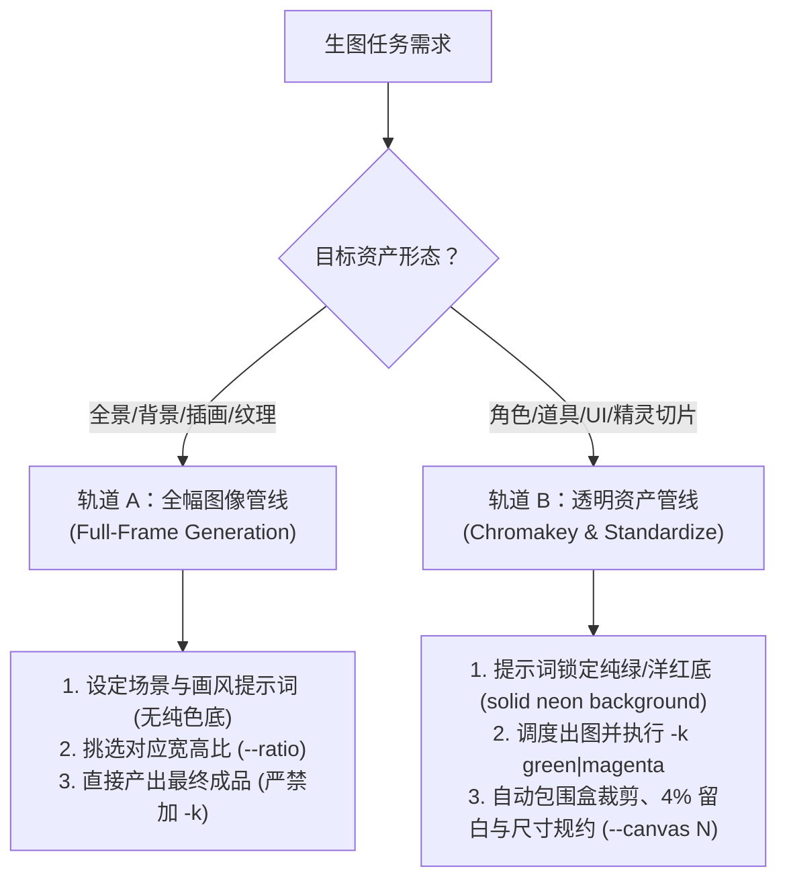

# agy-imagegen

提供高保真通用 AI 图像生成，并具备专业游戏与 UI 透明资产色键（Chromakey）工程化规约全流程管线。

---

## 1. 资产形态双轨决策（Asset Form Decision）

在生成图像前，**首先判定目标资产类型**以选择正确的管线：



| 资产类型 | 典型场景 | 核心策略 | 关键参数 |
| :--- | :--- | :--- | :--- |
| **全幅图像 (Full-Frame)** | 游戏场景、概念原画、网站横幅/Hero、壁纸、海报、材质贴图 | 丰富场景与光影构图，**不要纯色底，不使用抠图** | `--ratio 16:9\|9:16\|1:1\|4:3\|3:4\|2:3\|3:2` |
| **独立透明资产 (Isolated)** | 游戏精灵、角色立绘、Boss、武器道具、UI 图标、特效切片 | 纯色底生成 + 高性能色相差色键 + 去色溢 + 尺寸工程规约 | `-k green\|magenta --canvas <64\|96\|128\|256>` |

---

## 2. 执行宿主决策（Dual Engine）

| 模式 | 判定依据 | 调用方式 |
| :--- | :--- | :--- |
| **原生工具模式（优先）** | 当前会话环境中具备 `generate_image` 原生工具 | 直接调用内置 `generate_image` 产出图像至指定目录 |
| **CLI 包装模式（回退）** | 外部终端、CI 自动化或轻量子智能体环境 | 调用本机已安装在 PATH 中的 `agy-img` 命令调度出图 |

---

## 3. 标准作业流（SOP）

### 轨道 A：全幅图像生成流（背景 / 场景 / 插画）

无需任何后处理，直接生成高质量最终图像：

```bash
# 1. 宽屏场景原画 / 游戏背景（16:9）
agy-img "Cinematic fantasy castle on a floating island, waterfalls falling into clouds, golden hour sunset, matte concept art" -o assets/bg_castle.png --ratio 16:9

# 2. 移动端竖屏壁纸 / 启动页（9:16）
agy-img "Cyberpunk alleyway with neon hologram advertisements, wet asphalt reflection, volumetric mist, moody atmosphere" -o assets/splash.png --ratio 9:16

# 3. 垫图风格迁移（传入真实照片/草图，转为指定风格）
agy-img "Transform this sketch into a lush Studio Ghibli style watercolor illustration" -o assets/scene_ghibli.png --ref ./assets/draft_sketch.png --ratio 4:3
```

提示词镜头构图与画风锚点参见 [references/prompting.md](references/prompting.md)。

---

### 轨道 B：独立透明资产管线（立绘 / 精灵 / UI 图标）

大模型原生无法稳定生成 100% 干净透明背景的切片，必须使用**纯色底锁定 + 色键规约**：

#### 步骤 1：底色决策与提示词锁定
- **常规主体**（非绿色角色、武器、金币、UI 等）：
  - 提示词显式要求：`isolated on a solid pure neon green background (#00FF00), no shadows on background`
  - 抠图参数：`--bg green` 或 `-k green`
- **草木系 / 绿色系主体**（史莱姆、植物、绿发角色）：
  - 提示词显式要求：`isolated on a solid pure vivid magenta background (#FF00FF), no shadows on background`
  - 抠图参数：`--bg magenta` 或 `-k magenta`（避免绿色主体被误伤）

#### 步骤 2：生成与一步到位置换
CLI 原生支持生图的同时自动完成 40x+ 向量化抠图、边缘去色溢与尺寸居中：
```bash
# 出图并一步到位生成 256x256 透明立绘（保留 4% 呼吸留白）
agy-img "A fierce cyber wolf boss, glowing cyber armor, thick outlines, solid pure neon green background" -o raw-assets/boss_wolf.png -k green --canvas 256

# 绿色史莱姆精灵（使用洋红底，规约至 64x64）
agy-img "A cute green forest slime monster, pixel art style, solid pure vivid magenta background" -o raw-assets/slime.png -k magenta --canvas 64
```

#### 步骤 3：离线或批量色键处理（可选）
若已有批量的纯色底原图，使用随 CLI 全局就绪的 `chromakey` 命令进行后处理：
```bash
# 单图独立规约
chromakey art-inbox/sword.png -o raw-assets/sword.png --bg green --canvas 128

# 批量规约整个目录（内置同名消歧防覆盖机制）
chromakey art-inbox/ -o raw-assets/ --bg green --canvas 128
```
色相差计算公式与去色溢细节参见 [references/chromakey.md](references/chromakey.md)。

---

## 4. 边界与禁区
- **切勿混淆轨道**：全幅插画、背景壁纸**绝不要**使用纯色底或开启 `-k`，否则会将背景当成底色剔除导致画面破碎。
- **透明资产切勿假设原生透明**：千万不要写 `"transparent background PNG"` 期望模型原生透明，必须使用纯色底约束 + 色键工具。
- **并发控制**：不要并发同时启动多个 `agy-img` 进程（底层包含单实例互斥锁，多任务请顺序调度）。
- **资产工程化**：运行时游戏/Web 资产务必经过 `--canvas <N>` 规格化，避免巨幅原始位图消耗客户端内存。
