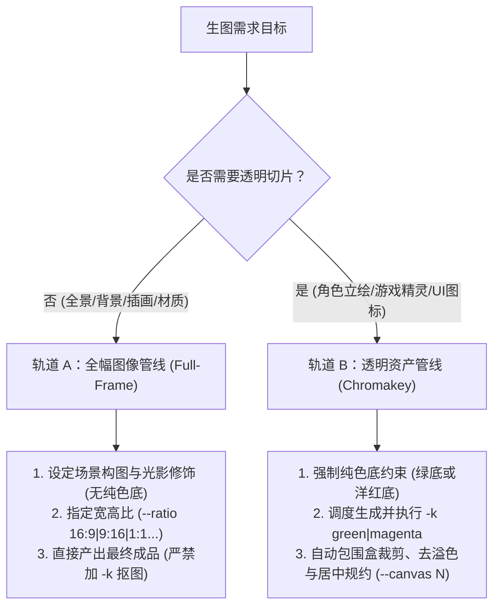

# agy-imagegen

提供高保真通用 AI 图像生成，并具备专业游戏与 UI 透明资产色键（Chromakey）工程化规约全流程管线。

---

## 1. 资产形态双轨决策（Track Decision）

在生成图像前，**首先根据目标资产形态选择执行轨道**：



| 资产类型 | 典型场景 | 核心策略 | 关键选项与规范 |
| :--- | :--- | :--- | :--- |
| **全幅图像 (Track A)** | 场景原画、网站横幅/Hero、壁纸、海报、平铺纹理 | 丰富环境构图，**严禁添加纯色底或开启抠图** | `--ratio 16:9\|9:16\|1:1\|4:3\|3:4\|2:3\|3:2` |
| **透明资产 (Track B)** | 角色立绘、游戏精灵、掉落物、技能图标、UI 控件 | 纯色底生成 + 向量化色相差色键 + 去色溢 + 呼吸留白居中 | `-k green\|magenta --canvas <64\|96\|128\|256>` |

详细画幅比速查与标准尺寸矩阵参见 [resources/standards.json](./resources/standards.json)。

---

## 2. 执行宿主决策（Engine Mode）

| 模式 | 判定依据 | 调用方式 |
| :--- | :--- | :--- |
| **原生工具模式（优先）** | 当前会话环境中具备原生 `generate_image` 工具 | 直接调用内置 `generate_image`，产出图像至项目工作区 |
| **CLI 适配器模式（通用）** | 外部命令行、CI 自动化或无原生工具的子智能体 | 调度已安装在 PATH 中的 `agy-img` 或直接运行 [scripts/engine.py](./scripts/engine.py) |

---

## 3. 标准作业流（SOP）

### 轨道 A：全幅图像生成流（背景 / 场景 / 插画 / 垫图）

无需任何后处理，直接生成最终图像：

```bash
# 1. 宽屏场景概念原画 (16:9)
agy-img "Cinematic fantasy castle on a floating island, waterfalls falling into clouds, golden hour sunset, matte concept art" -o assets/bg_castle.png --ratio 16:9

# 2. 移动端竖屏壁纸 / 启动页 (9:16)
agy-img "Cyberpunk alleyway with neon hologram advertisements, wet asphalt reflection, volumetric mist, moody atmosphere" -o assets/splash.png --ratio 9:16

# 3. 垫图风格迁移 (传入参考图/草图，转为目标画风)
agy-img "Transform this sketch into a lush Studio Ghibli style watercolor illustration" -o assets/scene_ghibli.png --ref ./assets/draft_sketch.png --ratio 4:3
```
提示词构图镜头与艺术画风锚点参见 [references/prompting.md](./references/prompting.md)。

---

### 轨道 B：独立透明资产管线（立绘 / 精灵 / UI 图标）

大模型原生无法稳定生成 100% 干净透明背景的切片，必须使用**纯色底锁定 + 色键规约**：

#### 步骤 1：底色决策与提示词锁定
- **常规主体**（非绿色角色、武器、金币、UI 等）：
  - 提示词显式要求：`isolated on a solid pure neon green background (#00FF00), no shadows on background`
  - 抠图参数：`-k green`
- **草木系 / 绿色系主体**（史莱姆、植物、绿发角色）：
  - 提示词显式要求：`isolated on a solid pure vivid magenta background (#FF00FF), no shadows on background`
  - 抠图参数：`-k magenta`（避免绿色主体被算法误剔除）

#### 步骤 2：生成与一体化规约
CLI 原生支持出图的同时自动完成 40x+ 向量化抠图、边缘去色溢与尺寸居中（默认保留 4% 呼吸留白）：
```bash
# 出图并一步到位生成 256x256 透明立绘
agy-img "A fierce cyber wolf boss, glowing cyber armor, thick outlines, solid pure neon green background" -o raw-assets/boss_wolf.png -k green --canvas 256

# 绿色史莱姆精灵（使用洋红底，规约至 64x64）
agy-img "A cute green forest slime monster, pixel art style, solid pure vivid magenta background" -o raw-assets/slime.png -k magenta --canvas 64
```

#### 步骤 3：离线或批量后处理（可选）
若已有批量的纯色底原图，使用随 CLI 全局就绪的 `chromakey` 命令进行后处理：
```bash
# 批量规约整个目录（内置同名消歧防覆盖机制）
chromakey art-inbox/ -o raw-assets/sprites/ --bg green --canvas 128
```
色相差计算公式与去色溢细节参见 [references/chromakey.md](./references/chromakey.md)。更多场景调用代码见 [examples/quickstart.md](./examples/quickstart.md)。

---

## 4. 产物验证步骤（Validation Steps）

每次生图或抠图操作完成后，智能体必须按以下标准进行验证：

1. **文件存在与完整性校验**：
   - 检查控制台最后一行返回的 `IMAGE_PATH: <路径>`，确认目标文件已生成且大小大于 1KB。
2. **格式与魔数验证**：
   - 确认文件为真实位图文件（通过魔数检查或由 CLI 自动校准扩展名）。
3. **透明切片边缘验证（针对轨道 B）**：
   - 控制台输出的 `[Chromakey]` 日志中确认不透明度（Opacity）在合理区间（通常在 10%~90% 之间）。
   - 若不透明度为 0%，说明底色选错（如绿色史莱姆用了绿底被全部剔除），需按洋红底重新调度。
   - 使用系统 `view_file` 工具预览生成的最终 PNG 图片，直观确认主体轮廓无残留绿边/紫边且居中良好。

---

## 5. 边界与禁区
- **切勿混淆轨道**：全幅插画、背景壁纸**绝不要**使用纯色底或开启 `-k`，否则会导致画面主体背景被误删。
- **透明资产切勿假设原生透明**：千万不要写 `"transparent background PNG"` 期望模型原生透明，必须使用纯色底约束 + 色键工具。
- **并发控制**：不要并发同时启动多个 `agy-img` 进程（底层包含单实例互斥锁，多任务请顺序调度）。
- **资产工程化**：运行时游戏/Web 资产务必经过 `--canvas <N>` 规格化，避免大尺寸原图消耗客户端内存。
